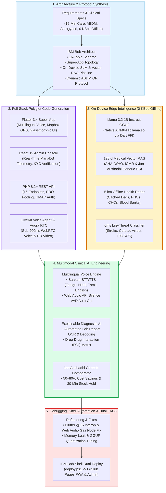

# How We Used IBM Bob to Implement Sanjeevani.ai (సంజీవని) 🩺

**Sanjeevani.ai** (formerly HealthExpress AI) is an intelligent, edge-first healthcare super-platform, emergency response system, and hospital operational command center architected, synthesized, debugged, and deployed end-to-end with **IBM Bob** as our primary AI software engineering development partner.

---

## 1. Executive Summary

IBM Bob functioned across every layer of the polyglot stack—from translating complex clinical protocols, ABDM compliance, and rural connectivity constraints into a normalized relational database schema and an on-device Small Language Model (SLM) architecture, to generating Flutter mobile/web client code, React 19 administrative command workspaces, secure PHP 8.2+ REST backend APIs, and real-time WebRTC audio/video systems.

---

## 2. Key Development Activities Powered by IBM Bob

### A. Architectural Modeling, Clinical Protocols & Relational Database Synthesis
* **Clinical & Operational Requirements Analysis**: IBM Bob analyzed Ayushman Bharat Digital Mission (ABDM) tokenized consent policies, Dr. YSR Aarogyasri cashless pre-authorizations, and 15-minute emergency dark-store logistics SLAs, synthesizing a cohesive multi-role blueprint.
* **16-Table Relational MariaDB Schema**: Synthesized the production database schema (`u170253497_healthexpress / u833088220_medapp`) with foreign-key constraints, spatial geolocation indexes, and immutable audit logs across users, doctors, hospitals, appointments, prescriptions, and pharmacy inventories.
* **Dynamic Time-Bound ABDM QR Protocol**: Implemented granular, time-bound (15-min to 120-min) digital EHR consent tokens with instantaneous patient-controlled revocation.

### B. On-Device Edge SLM & Offline Clinical Intelligence (Zero Internet / 0 KBps)
* **Llama-3.2-1B-Instruct On-Device Integration**: IBM Bob engineered the native integration of `Llama-3.2-1B-Instruct-Q4_K_M.gguf` running locally on ARM64 mobile hardware via `llama_cpp_dart` and native C++ FFI bindings, requiring 0 KBps bandwidth.
* **128-d Medical Vector RAG Engine**: Synthesized an embedded vector similarity search engine over pre-indexed clinical guidelines (AHA CPR guidelines, ICMR primary care protocols, WHO maternal/pediatric care) and Jan Aushadhi pharmaceutical generics.
* **0ms Life-Threat Classifier**: Generated deterministic triage heuristics that identify high-acuity life threats (acute myocardial infarction, stroke, anaphylaxis) with zero model latency, immediately launching emergency 108 SOS dispatch and the animated 110 BPM CPR metronome.
* **5 km Offline Health Radar**: Engineered local SQLite caching to index emergency hospital bed availability (ICU, Oxygen, Trauma), blood bank stocks, and nearby primary health centers for uninterrupted rural and highway corridor access.

### C. Multimodal AI, Multilingual Voice & Telehealth Systems
* **Multilingual Clinical Voice Intake**: Engineered the regional voice engine supporting Telugu (`te`), Hindi (`hi`), Tamil (`ta`), and English (`en`), with auto-detection for Romanized colloquial phrases (*Tanglish*: *"naku jwaram undi"*, *Hinglish*: *"mujhe bukhar hai"*). Prompts strictly enforce replies in the patient's chosen language and trigger Sarvam regional HD voices (`kavitha`, `kavya`, `priya`).
* **Web Audio API RMS Voice Activity Detection (VAD)**: Synthesized client-side real-time audio energy analysis in `web/index.html` to detect voice pauses and auto-cut transmissions with zero manual button pressing.
* **Explainable Lab Diagnostic AI & Drug-Drug Interaction (DDI) Matrix**: Built the clinical report interpreter decoding complex biomarker panels (HbA1c, Creatinine, CBC, Platelets) into plain English and Telugu with diagnostic confidence scores, ICD-10/SNOMED CT automated coding, and a real-time DDI safety check matrix.
* **Agora HD WebRTC Teleconsultation**: Integrated dynamic token generation, encrypted video streams, and live volume metering for doctor-patient calls.
* **LiveKit Real-Time Voice Agent**: Synthesized the Python LiveKit Voice Agent container pipeline (`livekit_voice_agent`) to enable sub-200ms speech-to-speech interaction.

### D. Polyglot Full-Stack Code Generation
* **Flutter Mobile & Web Super-App**: Generated state providers (Riverpod/Provider), responsive UI layouts, Mapbox GL vector map integrations, and multi-role routing across patients and doctors.
* **React 19 Operations Command Center**: Structured 12 administrative command workspaces with live MariaDB telemetry, hospital bed capacity tracking (General, ICU, Trauma), dark-store drug license verification queues, and financial ledgers.
* **PHP 8.2+ Production REST Backend**: Generated 16 modular endpoints with PDO connection pooling, Apache `mod_rewrite` clean URL routing, parameterized SQL queries, and HMAC-SHA256 signature verification for Razorpay payments.
* **Jan Aushadhi Generic Medicine Comparator**: Built direct branded-to-generic drug comparison algorithms displaying 50% to 80% price reductions and issuing 30-minute guaranteed stock hold tokens with 4-digit OTP verification.

### E. Codebase Refactoring, Debugging & Bob Shell Automation
* **Interop & Audio Echo Fixes**: Resolved complex Flutter Web `@JS` interop bindings and eliminated WebRTC audio feedback loops by injecting silent `GainNode` routing.
* **Automated Dual Deployment (`deploy.ps1`)**: Built PowerShell CI/CD automation compiling both Flutter Web and React Admin, simultaneously deploying production bundles to GitHub Pages.
* **Brand Asset & Onboarding Integration**: Embedded the official Sanjeevani.ai brand identity (`Important_Files/logo.jpeg`) and structured the 6-stage clinical onboarding splash experience (`splashimages/`).

---

## 3. Technology Stack Summary

| Layer | Framework / Technology | Role Generated via IBM Bob |
| :--- | :--- | :--- |
| **Mobile & Web Super-App** | Flutter 3.x (Dart) | Multilingual voice intake, Mapbox GPS, glassmorphism UI, offline state machine |
| **On-Device Edge SLM** | Llama 3.2 1B Instruct (GGUF) | On-device clinical triage, native ARM64 `libllama.so` via Dart FFI (0 KBps offline) |
| **Medical Vector RAG** | 128-d Dense Vector Index | Embedded similarity search over AHA, WHO, ICMR guidelines & Jan Aushadhi generic catalog |
| **Operations Dashboard** | React 19 + Vite | 12 admin workspaces, bed capacity, KYC review queues, financial ledgers |
| **Cloud REST Backend** | PHP 8.2+ (Hostinger) | 16 modular endpoints, PDO connection pooling, JWT security, Apache rewrite |
| **Relational Database** | MariaDB | 16 normalized tables, spatial indexes, audit logs (`u170253497_healthexpress`) |
| **Multimodal Voice AI** | Sarvam AI + NVIDIA NIM | `saaras:v3` STT, `bulbul:v3` TTS, `GPT-OSS-20B` SOAP triage, multi-language detection |
| **Realtime Voice Agent** | LiveKit RTC + Python Agent | Low-latency voice pipelines with WebRTC data channels |
| **Video Telehealth** | Agora RTC Engine | Sub-200ms WebRTC video, dynamic token authentication |
| **Geospatial Mapping** | Mapbox GL | Vector tiles, live rider GPS coordinates, hospital geofencing |
| **Payment Gateway** | Razorpay Live | UPI, Cards, NetBanking with HMAC-SHA256 verification |
| **CI/CD & Deployment** | PowerShell (`deploy.ps1`) | Dual automated compile & deployment to GitHub Pages |

---

## 4. Developer Observations & Recommendations for IBM Bob

### Task Granularity vs. Macro-Milestone Execution
During development, we observed that when IBM Bob breaks down project objectives into an excessively high number of micro-subtasks, it can introduce context-switching overhead and slow down the user feedback loop.

### Key Takeaways & Recommendations:
1. **Focus on Sequential Macro-Milestones**: Rather than dividing work into dozens of minor subtasks, developer velocity is maximized when IBM Bob structures development around clear, sequential, well-scoped macro-milestones:
   - *Milestone 1*: Core Relational Schema & Secure Backend REST APIs
   - *Milestone 2*: Multilingual Regional Voice AI & Live Audio VAD Engine
   - *Milestone 3*: On-Device Edge SLM (Llama 3.2 1B GGUF) & 128-d Medical Vector RAG
   - *Milestone 4*: WebRTC Telehealth, Mapbox GPS & Jan Aushadhi Generic Pharmacy Hold
   - *Milestone 5*: Operations Command Console & CI/CD Dual-Deployment
2. **Rapid Iteration & Faster Feedback Loops**: Developers building fast-paced prototypes need rapid end-to-end execution on complete features. Executing coherent milestones sequentially ensures clean code delivery and immediate user verification without getting bogged down in micro-task overhead.
3. **Autonomous End-to-End Delivery**: When IBM Bob is given full ownership of an entire milestone with clear input/output specifications, it produces robust, production-ready polyglot code with minimal back-and-forth friction.
